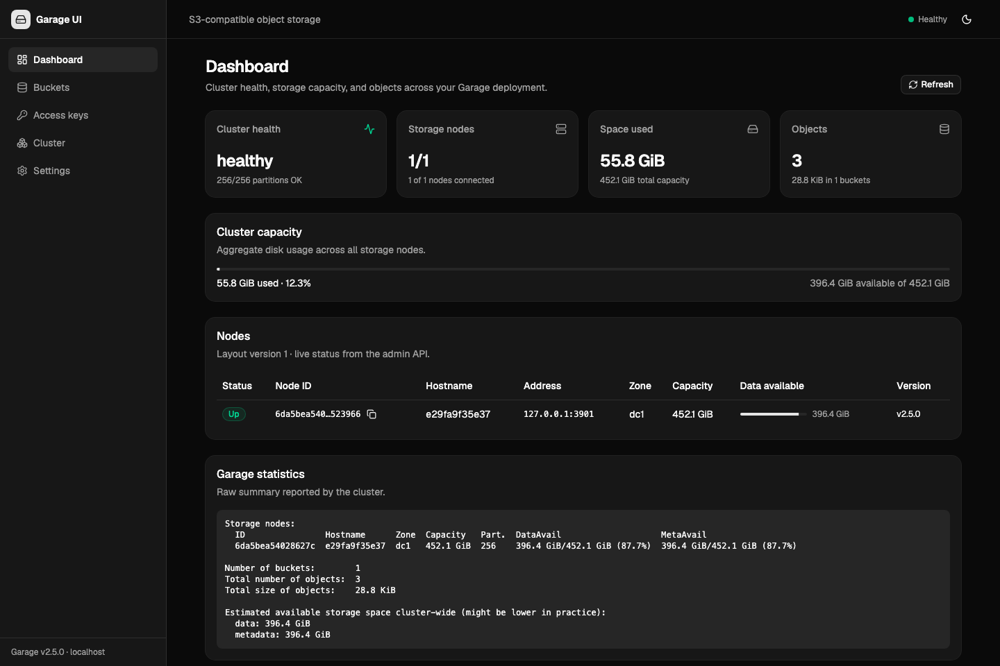

# Garage v2.5.0 — local setup & usage

Single-node Garage (S3-compatible object store) in Docker, with a Flask + React admin UI.



## Ports — what each one is

| Port | Service | What it is |
|------|---------|------------|
| 3900 | S3 API | Upload/download objects. This is the "real" API. |
| 3901 | RPC | Node-to-node cluster communication. |
| 3902 | S3 website | Static website hosting for buckets. **Not an admin UI.** |
| 3903 | Admin API | JSON REST API (`/v2/...`), requires `admin_token`. **Not a web UI.** |

**Garage has no built-in admin web UI.** 3902 only serves bucket websites (and returns
404 until website hosting is enabled on a bucket). 3903 is an API for scripts/curl.

A browser view of a bucket website is available at:
<http://default-bucket.web.garage.localhost:3902/> (resolves to 127.0.0.1).

## Start / stop

```bash
./run.sh                                  # (re)create container
docker logs -f garage-container           # logs
docker stop garage-container && docker start garage-container
docker rm -f garage-container             # remove (data survives in named volume garage-data)
```

## Credentials

Secrets are **not committed** — read them from the gitignored files:

- Access key ID → `backend/.env` (`GARAGE_S3_ACCESS_KEY`): `<access-key-id>`
- Secret key → `backend/.env` (`GARAGE_S3_SECRET_KEY`): `<secret-key>`
- Admin token → `garage.toml` (`[admin] admin_token`): `<admin-token>`
- Bucket: `default-bucket`
- S3 endpoint: `http://127.0.0.1:3900` (path-style, region `garage`)

> ⚠️ If any of these values were ever committed, rotate them: regenerate
> `admin_token`/`rpc_secret` in `garage.toml` and recreate the S3 access key, then update
> `backend/.env`.

## Working with objects

### AWS CLI (recommended)

```bash
brew install awscli

export AWS_ACCESS_KEY_ID=<access-key-id>
export AWS_SECRET_ACCESS_KEY=<secret-key>
export AWS_DEFAULT_REGION=garage
S3="aws --endpoint-url http://127.0.0.1:3900 s3"

$S3 ls                                   # buckets
$S3 ls s3://default-bucket/              # objects
$S3 cp ./file.txt s3://default-bucket/   # upload
$S3 cp s3://default-bucket/file.txt .    # download
$S3 rm s3://default-bucket/file.txt      # delete
$S3 sync ./dir s3://default-bucket/dir   # sync a directory
```

### curl (no install; uses SigV4 built into macOS curl)

```bash
AK=<access-key-id>
SK=<secret-key>
SIG=(--aws-sigv4 aws:amz:garage:s3 --user "$AK:$SK")
EP=http://127.0.0.1:3900

# upload
curl -sS "${SIG[@]}" -T index.html -H "Content-Type: text/html" \
  "$EP/default-bucket/index.html"

# list (XML)
curl -sS "${SIG[@]}" "$EP/default-bucket?list-type=2"

# download
curl -sS "${SIG[@]}" -o out.html "$EP/default-bucket/index.html"
```

### GUI clients

- **Cyberduck** (free): New Bookmark → S3 → server `127.0.0.1`, port `3900`,
  access key + secret key. Works well for browsing/uploading objects.
- **Transmit**, **ForkLift**, etc. also work as generic S3 clients.

## Static website hosting (port 3902)

```bash
# enable, with index/error documents
docker exec garage-container /garage bucket website --allow \
  --index-document index.html --error-document error.html default-bucket

# disable
docker exec garage-container /garage bucket website --deny default-bucket
```

Upload the files, then open:

<http://default-bucket.web.garage.localhost:3902/>

Without a browser (Host header):

```bash
curl -H "Host: default-bucket.web.garage.localhost" http://127.0.0.1:3902/
```

`*.localhost` resolves to 127.0.0.1 on macOS; on other machines add an `/etc/hosts` entry.

## Admin API (port 3903)

```bash
TOKEN=<admin-token>
H="Authorization: Bearer $TOKEN"
A=http://127.0.0.1:3903/v2

curl -s -H "$H" $A/GetClusterStatus   # nodes, capacity, health
curl -s -H "$H" $A/ListBuckets
curl -s -H "$H" $A/ListKeys
curl -s -H "$H" $A/GetBucketInfo?globalAlias=default-bucket
```

## Garage CLI (inside the container)

```bash
G="docker exec garage-container /garage"

$G status
$G bucket list
$G bucket info default-bucket
$G key list
$G key create my-app                  # prints a new key ID + secret
$G bucket allow --read --write --key my-app default-bucket
$G bucket deny  --read --write --key my-app default-bucket
$G stats
```

## Config notes

`garage.toml` sets:

- `metadata_dir = /var/lib/garage/meta`, `data_dir = /var/lib/garage/data`
  (persisted in the named volume `garage-data`).
- `replication_factor = 1` — required for `--single-node`.
- No `root_domain` under `[s3_api]`, so the S3 API uses **path-style** URLs
  (`http://host:3900/bucket/key`), which is easiest for local clients.
  To switch to virtual-host style, add `root_domain` + `public_endpoint`.
- Website `root_domain = ".web.garage.localhost"` under `[s3_web]`.

## Admin UI (Flask + React)

A browser UI for this Garage instance lives in `backend/` (Flask proxy over the admin and
S3 APIs) and `frontend/` (Bun + Vite + TypeScript + React + Tailwind + shadcn/ui).

```bash
./dev.sh          # installs deps on first run, then starts both servers
```

- UI: <http://localhost:5173>
- Backend API: <http://127.0.0.1:5000/api/health>
- Config/secrets: `backend/.env` (backed by the admin token and service key below).

Features: cluster dashboard (health, nodes, capacity, statistics), buckets
(create/delete, website hosting, quotas, aliases), access keys (create with one-time
secret, reveal, delete), per-bucket permissions (read/write/owner) and an object browser
(list folders, upload, download, delete).

A **Cluster** page adds the full administration surface on top of Garage's Admin API:
node details and statistics, cluster layout staging/preview/apply/revert (guarded and
read-only when running `--single-node`), operations (workers, repairs, block errors,
metadata snapshots) and scoped admin tokens (created with a one-time secret).

The UI has no login and binds to 127.0.0.1. Object browsing uses the service key in
`backend/.env`; grant it access to a bucket from the bucket's **Permissions** tab (or keep
the default checked option when creating a bucket).